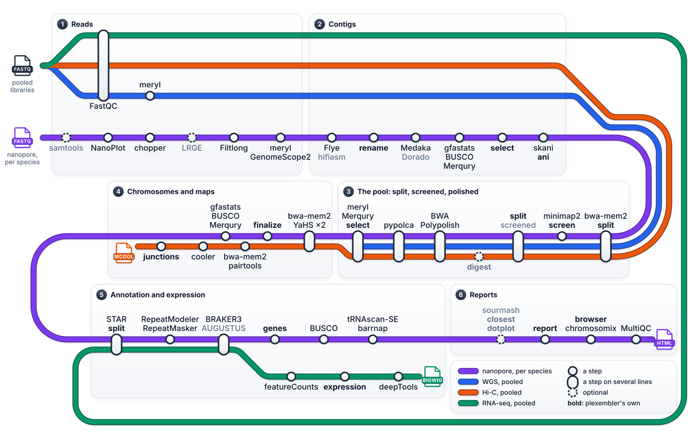

# plexembler

[](https://www.nextflow.io/)
[](https://github.com/js2264/plexembler/actions/workflows/pipeline.yml)
[](https://github.com/js2264/plexembler/actions/workflows/ci.yml)
[](https://js2264.github.io/plexembler/)
[](https://codecov.io/gh/js2264/plexembler)
[](LICENSE)
[](https://github.com/astral-sh/ruff)

<picture>
  <source media="(prefers-color-scheme: dark)" srcset="docs/assets/metro_map_dark.svg">
  
</picture>

Reference genomes, gene annotations, Hi-C maps and expression tables for every
species of a pool, from per-species nanopore reads and pooled Hi-C, WGS and
RNA-seq.

Each species of a pool has its own nanopore reads; the Hi-C, WGS and RNA-seq
libraries are made once, from the cells of every species mixed in one tube.
plexembler assembles each species from its nanopore reads, splits the pooled
libraries between the species by competitive mapping, and gives each species
its polished, screened and scaffolded genome, its gene annotation, its Hi-C
map, its expression table and its report.

> [!NOTE]
> plexembler is being built, milestone by milestone: today it makes each
> species' contigs, splits the pooled libraries between the species, screens
> and polishes the contigs, scaffolds them into chromosomes with Hi-C, annotates
> their repeats and genes, writes their expression tables, tracks, reports
> and a chromosomix store, and, with a sourmash database, finds each species'
> closest known genome and draws its dotplot against it. Each milestone has steps still to come:
> [the implementation plan](https://js2264.github.io/plexembler/plan/) says
> which.

## Install

```bash
# 1. uv
curl -LsSf https://astral.sh/uv/install.sh | sh && . ~/.local/bin/env
# 2. [Optional] micromamba, to run the tools without Docker or Apptainer
curl -Ls https://micro.mamba.pm/api/micromamba/linux-64/latest | tar -xj -C ~/.local bin/micromamba
# 3. plexembler, with Nextflow's launcher and Java
uv tool install 'plexembler[java]'
# 4. Run it on the test data (-profile test,docker without micromamba)
plexembler run -profile test,micromamba --outdir results
```

On an Apple silicon Mac, micromamba's URL ends in `osx-arm64`. Without the
`java` extra, Nextflow runs on the machine's Java, 17 or newer.
`plexembler run` runs `nextflow run js2264/plexembler -r v<version>`, the
pipeline of the release installed, and passes it every other argument: with a
Nextflow of your own (26.04.0 or newer), `nextflow run js2264/plexembler`
takes the same.

## Quick start

```bash
# with micromamba (step 2): AUGUSTUS's genes, BRAKER3 having no conda environment
plexembler run -profile micromamba --gene_predictor augustus \
    --input species.csv --libraries libraries.csv --outdir results

# with a container engine: BRAKER3's genes
plexembler run -profile docker \
    --input species.csv --libraries libraries.csv --outdir results
```

## Documentation

<https://js2264.github.io/plexembler/>: [concepts](https://js2264.github.io/plexembler/concepts/),
[usage](https://js2264.github.io/plexembler/usage/),
[outputs](https://js2264.github.io/plexembler/output/),
[the implementation plan](https://js2264.github.io/plexembler/plan/) and
[how to cite plexembler](https://js2264.github.io/plexembler/citation/).
