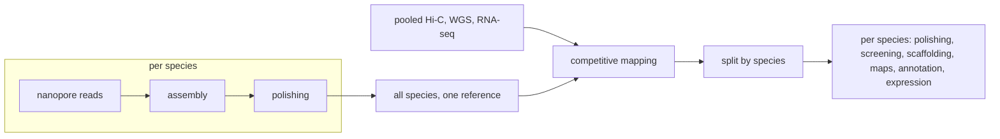

# Concepts

The ideas plexembler is built on, and the words this documentation uses for them.

## A pool and its species

A **pool** is a set of species whose cells were mixed in one tube to make
**pooled libraries**: one Hi-C library, one WGS library and, optionally, one or
more RNA-seq libraries, each sequenced once for all the species. Each
**species** of the pool also has nanopore reads of its own, sequenced apart.

plexembler makes, for each species, a genome reference, its annotation, its
Hi-C map, its expression table and its report. A run can hold several pools:
their species never meet.

## The nanopore reads give each contig its species

Since each species' nanopore reads are its own, the contigs assembled from them
belong to it from the start. Every contig is named after its species,
`<species>_<contig>`, from the moment it is assembled
([`plexembler rename`](cli.md#rename)), which is why a species' ID has no
underscore: the first one of a contig's name ends the species.

## Deconvolution: the pool, split between its species { #deconvolution }

The pooled libraries are not split by barcodes: their reads are split between
the species by **competitive mapping**. The contigs of every species of a pool
are put in one reference; each read pair is mapped on it; a pair whose best
alignment is unique enough goes to the species its contig's name starts with.
The step, `POOL_DECONVOLVE`, is the only one that sees all the species of a
pool at once:

It runs three times, each time on the newest version of the genomes: on the
nanopore-polished contigs, to polish them with the species' WGS reads; on the
polished contigs, to screen them and to scaffold them with the species' Hi-C
pairs; and on the final genomes, for the maps, the annotation's evidence, the
expression and the coverage tracks.

A read that maps as well on two species is **ambiguous**, and goes to neither.
The fraction of ambiguous reads of each pair of species is reported: it grows
as two species get closer, and above about 95 % identity the short reads of the
pool can no longer tell them apart in conserved regions.

## The pool as its own control

Pooling gives controls a single-species library has not:

- **The noise floor of the Hi-C library.** In vivo, a contact joins two loci of
  one nucleus, so of one species: a pair between two species can only come
  from ligation at random, in solution. If a fraction ε of the pairs are
  random, and species *i* makes a share *pᵢ* of the library, the fraction of
  pairs between species is ε (1 − Σ *pᵢ*²): the library's own rate of random
  ligation, ε, is read off it, and so is how much of each species'
  inter-chromosomal signal is noise.
- **Contigs of the wrong species.** Barcode bleed-through between nanopore runs,
  or a contaminated culture, puts another species' reads in a species' data:
  mostly its high-copy DNA (mitochondrial genome, rDNA, plasmids), which then
  assembles. Such a contig is found by three signals that agree: the nanopore
  reads of the other species cover it more, it is nearly identical to a contig
  of the other species, and its Hi-C contacts are with the other species'
  contigs.
- **Each species' share of each library**, and so its depth in each.

## Candidates: where the pipeline branches

Where more than one tool is worth running, the pipeline runs several and keeps
the results as **candidates**: assemblers (Flye, hifiasm) and scaffolders
(YaHS, instaGRAAL, HapHiC). Every candidate of a species goes through the same
checks; one is **selected**, by a rule the report shows, or by the samplesheet,
which can name it. The others stay in the results, for comparison.

The pipeline does not branch between scaffolding each species and scaffolding
the pool: scaffolding is per species, after the deconvolution. Scaffolding the
pool's joint reference would ask the scaffolder to find each contig's species,
which the nanopore reads already give, and would allow joins between species.

## Curation

A Hi-C map shows a scaffolder's mistakes. Each candidate's map is written for
[PretextView](https://github.com/sanger-tol/PretextView) (`.pretext`) and
[Juicebox](https://github.com/aidenlab/Juicebox) (`.hic`), with its AGP; a
species' row of the samplesheet can then give a curated AGP, which the pipeline
takes up again at the finishing step.

## The words

| Word | Meaning |
|---|---|
| pool | The species whose cells were mixed to make one set of pooled libraries |
| species | One genome to build: a row (or several, one per nanopore run) of `--input` |
| library | A pooled Hi-C, WGS or RNA-seq library: a row (or several, one per run) of `--libraries` |
| deconvolution | The pooled reads, split between the species by competitive mapping |
| ambiguous | A read that maps as well on two species, and goes to neither |
| candidate | The result of one tool, among several run for the same step |
| T2T | Telomere to telomere: a chromosome with telomeric repeats at both ends |
