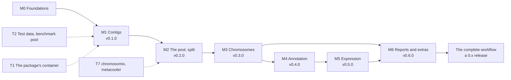

# Implementation plan

How plexembler gets from its scaffold to the pipeline that [concepts](concepts.md)
describes. The work is cut into **milestones**, each a release that runs on real
data, and **tracks** that run beside them. A box is ticked in the pull request
that delivers it; a decision taken along the way is written where it applies.

## Versions: 0.x, for good

plexembler stays at 0.x, the complete workflow included: there is no 1.0.0 in
this plan. CONVENTIONS.md § 18 allows a minor release before 1.0 to break the
interface, and that is the freedom kept.

- **A milestone is a minor release** (v0.1.0 for M1, … v0.6.0 for M6), and so
  is every feature after them: the minor number has no ceiling (v0.10.0 follows
  v0.9.0). `uv run bump-my-version bump minor` or `bump patch`, never `bump
  major`.
- **The complete workflow** is the first release in which every box of M1 to M6
  is ticked and `test_full` is green: a 0.x release like the others, named so
  in its changelog section and in the README.
- **A patch release only fixes**, and never breaks a run.
- **A minor release may break**, said where it does: a *Breaking changes*
  section in its changelog, and `docs/upgrading.md`, a page on moving a run to
  it (CONVENTIONS.md § 9). What can be renamed is first deprecated, with a
  warning, for one minor release (§ 18): a parameter, a samplesheet column, an
  output path, a key of the report.
- **Runs pin their release** (`nextflow run js2264/plexembler -r v0.7.2`):
  [usage](usage.md) says so, and every report names the release it was made
  with.
- **nf-core releases a pipeline from 1.0.0**, so plexembler stays
  nf-core-compatible rather than becoming an nf-core pipeline (T6).

## How a step is built

Every box below is done when all of this is:

1. **Its tools.** An nf-core module (`nf-core modules install`), or a local
   module in nf-core's form: `modules/local/<tool>/`, a conda environment and
   its Seqera container, a `stub:` block, versions in the `versions` topic, a
   `meta.yml`. Logic of plexembler's own is a `plexembler <command>` (Python,
   tested in-process, 80 % covered) that a local module runs: never a `bin/`
   script.
2. **Its subworkflow**, under `subworkflows/local/<name>/`, with nf-test: a real
   test and a `-stub` test, on `tests/data/` (the plumbing) and, from M1, on the
   benchmark pool's small set (T2).
3. **Its configuration.** Arguments and publishing in `conf/modules.config` (a
   species' results under `species/<species>/`, a pool's under `pools/<pool>/`),
   resources by label in `conf/base.config`, parameters in `nextflow.config` and
   `nextflow_schema.json` (then `docs/parameters.md`).
4. **Its documentation.** Its outputs in `docs/output.md`, its parameters and
   columns in `docs/usage.md`, its tools in `CITATIONS.md` and
   `toolCitationText()`, its entry in `docs/changelog.md`.
5. **Its numbers in MultiQC**, through MultiQC's own module for the tool or the
   step's `_mqc` file, and, from M6, in the species' report.

## M0 · Foundations

The repository, and what every later step relies on. Not released.

- [x] The pipeline on nf-core's template (nf-core/tools 4.2.2, strict syntax,
      topic channels, nf-schema 3, Nextflow ≥ 26.04.0), the package on
      chromokit's copier template, the docs site in chromokit's look.
- [x] The species and pooled libraries samplesheets: relative paths read from
      the samplesheet's folder, rows of a species or a library merged, pools
      checked against each other.
- [x] The reads' QC: NanoPlot per species, FastQC per pooled library, MultiQC.
- [x] `plexembler rename` (`<species>_<contig>`), and the command line's log
      (CONVENTIONS.md § 11).
- [x] CI: the package (`ci.yml`), the pipeline (`pipeline.yml`: lint, nf-core
      lint, nf-test on Nextflow 26.04.0 and the newest), the docs, the
      changelog check, the release, Dependabot.
- [ ] GitHub's settings (T5).
- [ ] The benchmark pool's small set, `test-data-v1` (T2).
- [ ] The package's container, which M1's local modules need (T1).

## M1 · Contigs, per species · v0.1.0

**Goal:** for each species, its nanopore contigs, polished, with their checks;
usable as a draft genome on its own.

- [ ] **Nanopore input.** FASTQ or Dorado's unaligned BAM (`samtools fastq -T '*'`,
      keeping its tags); filtered by length and quality (`chopper`); capped at
      `--ont_max_depth` (100×) of the longest reads (`filtlong --target_bases`,
      or `rasusa`). The samplesheet's `ont` takes `.bam`.
- [ ] **What the samplesheet leaves unknown** (`NA`): the genome size, from the
      nanopore reads (LRGE), before the depth cap needs it; the ploidy, from the
      k-mer spectrum of the species' nanopore reads (GenomeScope2, Smudgeplot),
      then of its own WGS reads once M2 has split them, the species treated as
      haploid until then. Each estimate is reported as one, beside what the
      samplesheet gave when it gave something.
- [ ] **Assemblers, as candidates** (`--assemblers flye,hifiasm`): Flye
      `--nano-hq` by default, `--genome-size` from the samplesheet or its
      estimate; hifiasm
      `--ont` for heterozygous species, its haplotypes kept as candidates
      (nf-core: `flye`, `hifiasm`).
- [ ] **Contigs named after their species:** `plexembler rename`, in a local
      module `PLEXEMBLER_RENAME`.
- [ ] **Nanopore polishing** (`--ont_polisher medaka|dorado|none`): Medaka
      (nf-core `medaka`); `dorado polish` (local, `process_gpu`) for Dorado's
      BAMs.
- [ ] **The genome checks**, a subworkflow `GENOME_QC` that every later stage
      reuses: `gfastats` (contiguity); BUSCO in genome mode, or compleasm, with
      the samplesheet's lineage or BUSCO's choice; Merqury's QV against the
      pool's WGS k-mers (valid per species: an assembly k-mer missing from the
      pool is an error) and its completeness against the species' own nanopore
      k-mers (the pool's short reads mix the species); the assembly graph (GFA).
- [ ] **One candidate kept:** `plexembler select --step assembly`: BUSCO
      complete minus duplicated, then QV, then contig N50; a samplesheet column
      `assembler` names one instead. Every candidate stays under
      `species/<species>/candidates/assembly/`.
- [ ] **Identity between the species of a pool:** `skani` → a matrix; a warning
      above 95 % ANI, where the pool's short reads stop telling two species apart.

**Done when**, on the benchmark pool (T2): each species' BUSCO is within 1 point
of its reference's; QV ≥ 40 after polishing; QUAST against the T2T references
finds no misassembly over 10 kb in the kept candidate.

## M2 · The pool, split · v0.2.0

**Goal:** the pooled libraries split between the species; the contigs polished
with their own species' short reads (WGS, or Hi-C cut at its junctions), and
screened.

- [ ] **`POOL_DECONVOLVE`**, the pool-level subworkflow
      ([concepts](concepts.md#deconvolution)): the contigs of every species of a
      pool in one reference; `bwa-mem2` (`-5SP` for Hi-C); pairs sorted by name;
      `plexembler split` (pysam, in a local module) gives each pair to the species
      of its best unique alignments: WGS proper pairs, Hi-C pairs whose mates
      both land in one species (pairs between species counted, not kept), at
      `--deconvolve_mapq` (20). It writes each species' BAM (and FASTQ where a
      tool wants reads) and the pool's numbers: each species' share of each
      library, the ambiguous fraction of each pair of species, the pairs between
      species and the random-ligation rate ε. The pool's channels are grouped
      with `groupKey(pool, n_species)`, so that a pool starts as soon as its own
      species are ready.
- [ ] **The polishing reads** (`--polish_reads auto|wgs|hic|both`, `auto` by
      default): a species' WGS pairs when its pool has a WGS library; when it has
      none, or for a species whose WGS depth is under `--min_polish_depth`
      (30×), its **Hi-C reads, cut at their ligation junctions**. A Hi-C read is
      chimeric at a junction, but the pieces between junctions are genome, read
      with the same chemistry as WGS. `plexembler digest` cuts each read with
      hicstuff's rule (`cutsite_read`: 4 bases into the junction, so that each
      piece keeps its half of the site), from the junctions of the library's
      `enzymes` (DpnII's `GATCGATC`; Arima's four); drops the pieces under
      `--min_piece` (40 bp); and writes every piece once, as single-end reads:
      a Hi-C pair is two loci, not a fragment, and its pairing would mislead a
      polisher. Before cutting, duplicate pairs go (Hi-C libraries carry more
      PCR duplicates than WGS: `pairtools dedup` on the pool's Hi-C alignments),
      and a piece takes the species its pair was given. The reads with 0, 1 and
      2 or more junctions are counted: a ligation-efficiency figure for the
      report. (hicstuff's own `cutsite` pairs the pieces again; a mode of it
      that writes them once, unpaired, would replace `plexembler digest`, T4.)
- [ ] **Short-read polishing** (`--sr_polisher polypolish,pypolca|none`):
      Polypolish on `bwa mem -a` alignments of the species' reads, single-end for
      Hi-C pieces (its insert-size filter needs true pairs), alignments with
      more than 5 clipped bases dropped (a junction the cutting missed); then
      pypolca. Hi-C's coverage is uneven, highest near restriction sites: a base
      it does not cover is left as it was, not changed. The guard: Merqury's QV
      before and after on k-mers of 10 % of the pairs, held out of the polishing
      (the polishing reads' own k-mers would flatter it, and Hi-C's uneven
      coverage makes a QV from its k-mers pessimistic); the polished version is
      kept only if it is better (`plexembler select --step polish`).
- [ ] **Micro-C** (`enzymes` is `none`) has no junction sequence to cut at:
      such a pool's species stay polished with nanopore reads alone, by default.
      Polishing with the clipped local alignments of its reads (primary and
      supplementary segments, the clipped bases left out) is tried on the
      benchmark first, and offered only if it helps.
- [ ] **The pool's Hi-C map, species as genomes:** every Hi-C pair of the
      pool, those between species included, binned on the pool's contigs as a
      `.metacool` whose genomes are the species (`metacooler create pairs`, the
      contig-to-species table from the contigs' names). `metacooler qc`, `ps
      --by genome` and `network` give each species' contacts, P(s) and the
      contacts between species, the noise floor's raw material; chromosomix
      opens it as it opens a metagenome's map.
- [ ] **The contig screen,** `plexembler screen`, which weighs three signals for
      each contig: the nanopore reads of every species of the pool mapped on the
      pool's contigs (`minimap2 -x map-ont`, the pool's cross-talk matrix); its
      identity to the other species' contigs (`minimap2 -x asm10`); and its Hi-C
      contacts outside its species, from `chromosomix magpurity` on the pool's
      `.metacool` (organelles left out: their contacts are mostly random
      ligation). A verdict per contig, keep, move or drop, with its evidence; a
      move is applied with `metacooler reassign`.
- [ ] **Organelles and plasmids:** the mitochondrial contig, by circularity, GC,
      depth and `miniprot` hits of a small set of yeast mitochondrial proteins
      (`assets/`), kept apart as `<species>_chrM`.
- [ ] **Foreign DNA:** FCS-adaptor always; FCS-GX with `--fcsgx_db` (nf-core's
      subworkflow `fasta_clean_fcs`); Tiara's labels (eukaryote, prokaryote,
      organelle) for the report.
- [ ] **Haplotigs:** purge_dups for a species whose new column `purge` says so;
      never by default, never for a hybrid (it would remove a subgenome).
- [ ] **The pool's Hi-C on the screened contigs** (a second `POOL_DECONVOLVE`),
      which M3 scaffolds with.

**Done when**, on the benchmark pool: ≥ 99.5 % of the assigned pairs go to their
true species (the reads' names carry it) for pairs of species below 90 % ANI;
ε within 10 % of the simulated rate; every planted bleed-through contig moved
or dropped; no species' QV lower after polishing; polishing with digested Hi-C
alone gains at least 80 % of what WGS gains, species by species.

## M3 · Chromosomes · v0.3.0

**Goal:** each species' genome, scaffolded with its Hi-C pairs and finished, and
its Hi-C maps.

- [ ] **Pairs per species:** `pairtools parse/sort/dedup/stats` on the species'
      Hi-C alignments (4DN `.pairs.gz`, with the `#chromsize` lines instaGRAAL
      reads; pairtools' stats in MultiQC).
- [ ] **Scaffolders, as candidates** (`--scaffolders yahs,instagraal,haphic`):
      - YaHS (nf-core `yahs`), its motifs from the library's `enzymes`;
      - instaGRAAL, a local module `INSTAGRAAL_ENDTOEND`:
        `instagraal-endtoend contigs.fa pairs.gz -e <enzymes> --mode cpu`, or
        `--instagraal_mode default` (MCMC and refine) on a GPU (`process_gpu`);
        not for a library made without an enzyme;
      - HapHiC (local), for species with a `ploidy` of 2 or more and an
        `n_chromosomes`.
- [ ] **Layouts as AGP:** `plexembler agp`: instaGRAAL's `final_info_frags.txt`
      to AGP (until instaGRAAL writes one, T4); AGP to FASTA, checked against the
      contigs.
- [ ] **Each join scored:** `plexembler junctions`: the contacts across each
      junction against the species' own contact decay P(s) (cooler), and the
      joins they do not support; `instagraal-refine`, which scores the joins of
      a layout, as a second opinion.
- [ ] **Telomeres:** `tidk explore` finds the repeat when the samplesheet has
      none, `tidk search` counts the chromosomes with telomeres at both ends
      (nf-core's subworkflow `fasta_explore_search_plot_tidk`).
- [ ] **One candidate kept:** `plexembler select --step scaffold`: no unsupported
      join (unless every candidate has some), then the most T2T chromosomes,
      then the number of scaffolds nearest `n_chromosomes` (a term left out when
      it is `NA`, and HapHiC, which needs it, skipped), then N50; a samplesheet
      column `scaffolder` names one instead. The karyotype found, T2T
      chromosomes first, is reported against the one given.
- [ ] **Curation:** a samplesheet column `curated_agp` replaces the kept layout
      with a curated one, checked against the contigs; each candidate's `.pretext`
      and `.hic` with its AGP are written for PretextView and Juicebox.
- [ ] **Finishing:** `plexembler finalize`: chromosomes named by size
      (`<species>_chr01`, …), `<species>_chrM`, `<species>_unplaced_01`; gap
      closing (TGS-GapCloser, local) and telomere extension (teloclip, local)
      behind `--close_gaps` and `--extend_telomeres`; bgzip, `.fai`, `.gzi`,
      `chrom.sizes`, AGP. A related reference (`--orient_reference`) can orient
      the chromosomes (`ragtag`), never reorder them.
- [ ] **The pool on the final genomes** (a third `POOL_DECONVOLVE`: WGS, Hi-C).
- [ ] **Maps:** `cooler cload pairs`, `zoomify --balance` (`.mcool`); `.hic`
      (hictk, local); `.pretext` and PNG (`pretextmap`, `pretextsnapshot`); the
      pool's map on the final genomes, a `.metacool` again, where the blocks
      between species show the noise.
- [ ] **The maps' checks, by chromosomix's command line:** `chromosomix
      pairsqc` per species (pair classes against the library's enzymes, distance
      to the cut, the four orientations' P(s)), `chromosomix stats` (pairtools'
      counts, for MultiQC), `chromosomix mapreport` (the map's report, its
      MultiQC sections), `chromosomix expected` (the P(s) that
      `plexembler junctions` scores joins against).

**Done when**, on the benchmark pool: ≥ 90 % of the reference chromosomes are
T2T in the kept candidate; no misjoin against the T2T references; the
benchmark's planted misjoins are flagged by `plexembler junctions`.

## M4 · Annotation · v0.4.0

**Goal:** each species' genes (GTF, GFF3, proteins), repeats, non-coding RNAs and
mitochondrial genes.

- [ ] **Repeats:** RepeatModeler2 (a library per species), RepeatMasker →
      soft-masked genome and repeat landscape.
- [ ] **RNA-seq, split:** STAR on the pool's final genomes (introns capped at
      5 kb, `--alignIntronMax 5000 --alignMatesGapMax 5000`: compact genomes get
      false splices otherwise), `plexembler split --type rnaseq` (unique hits);
      each species' libraries merged for the gene models.
- [ ] **Genes:** BRAKER3 `--fungus` (nf-core `braker3`) with the species' RNA
      alignments and OrthoDB's fungal proteins (`--orthodb_proteins`, downloaded
      to the cache when absent). Without RNA-seq: BRAKER on proteins alone, or
      GALBA (local), whichever does better on the benchmark. Helixer (local,
      GPU) as a second candidate (`--gene_predictors braker,helixer`), scored by
      BUSCO's proteins and OMArk.
- [ ] **Formats:** AGAT (`agat/convertspgff2gtf`, `agat/spextractsequences`,
      `agat/spstatistics`): GTF and GFF3, locus tags `<species>_000010`, proteins
      translated with the species' `genetic_code` (CUG is a sense codon in tables
      1, 12 and 26 alike: gene structures do not change, proteins do), CDS.
- [ ] **The genetic code, checked:** Codetta (Shulgina and Eddy 2021) infers each
      species' nuclear code from its genome: it is the code used when the
      samplesheet says `NA`, and a warning when it differs from the one given.
- [ ] **Non-coding RNAs:** tRNAscan-SE (`-E`), barrnap (`--kingdom euk`: the rDNA
      locus), Infernal with Rfam.
- [ ] **Functions:** eggNOG-mapper (orthologue names, GO, KEGG, EC, Pfam) →
      `functions.tsv`; InterProScan with `--interproscan_db`.
- [ ] **The mitochondrial genome's genes,** with the yeast mitochondrial code
      (table 3): MitoHiFi in its contig mode, or MFannot; the one that annotates
      the benchmark's mitochondria best.
- [ ] **Annotation checks:** BUSCO's proteins, OMArk (local), AGAT's statistics,
      the RNA-seq reads in genes.

**Done when**, on the benchmark species with reference annotations: ≥ 90 % of
the reference genes found (gffcompare); BUSCO's proteins within 2 points of
BUSCO's genome.

## M5 · Expression and tracks · v0.5.0

**Goal:** each species' expression table, and its coverage tracks.

- [ ] **Counts:** featureCounts on each RNA-seq library's per-species
      alignments, its strandedness from Salmon's library type.
- [ ] **TPM:** Salmon on the pool's transcripts, every species with its genome
      as decoy, so that a read of a gene shared by two species is shared by
      Salmon's EM; TPM within each species, from that species' reads alone.
      `plexembler expression` writes `<species>.counts.tsv` and
      `<species>.tpm.tsv`: genes × libraries (`<condition>_<replicate>`), and each
      gene's ambiguous fraction.
- [ ] **Tracks:** bigWig of the RNA-seq (by strand), the WGS and the nanopore
      reads (`deeptools bamCoverage`, `mosdepth`).

**Done when**, on the benchmark pool's simulated RNA-seq (known TPMs):
Spearman's ρ ≥ 0.9 for every species.

## M6 · Reports and extras · v0.6.0

- [ ] **`plexembler report`**, on chromokit's report kit (CONVENTIONS.md § 12):
      per species, `report.txt`, its MultiQC row and its page: the summary;
      its share of the pool; the candidates and the choice; contamination; a
      karyotype (chromosomes, telomeres, centromeres, rDNA, chrM); BUSCO, QV,
      OMArk; the annotation; the expression; versions and methods. A pool's
      report beside it (`pools/<pool>/`).
- [ ] **Contamination, further:** EukCC; a GC × depth plot of the contigs,
      labelled by Tiara, FCS-GX and the screen.
- [ ] **Ploidy, heterozygosity, aneuploidy:** Clair3 (nanopore) and bcftools (WGS)
      → allele balance; `mosdepth` by chromosome → copy number; Smudgeplot on the
      species' WGS reads.
- [ ] **Centromeres from Hi-C:** `plexembler centromeres`, from the
      inter-chromosomal contacts of the Rabl configuration, as centurion does
      (Varoquaux et al. 2015; Marie-Nelly et al. 2014) → `centromeres.bed`.
- [ ] **Each species' identity:** ITS (ITSx, local) and the D1/D2 domain of the
      28S rRNA, against a local UNITE or NCBI set (BLAST): sample swaps show.
- [ ] **Comparative**, per pool (`--comparative`): OrthoFinder (orthogroups,
      species tree), synteny (GENESPACE, local), the ANI matrix of M1.
- [ ] **A browser for the delivery: chromosomix.** `plexembler browser` writes,
      for each species, a workspace (`<species>.chromosomix.json`: its map with
      its genome, genes, repeats, telomeres, centromeres and coverage tracks
      placed, a colour scale, a first window), and, at the top of the results, a
      store (`chromosomix.store.json`, `layout: cards`, one card per species,
      grouped by pool) whose rows name every map, genome, track and workspace
      by a relative path. The results then open in chromosomix as they are: its
      web app, desktop app or single-file HTML with the results folder
      connected, or chromosomix.app with `?store=<url>` once the folder is on a
      bucket; the species' report embeds its view (`?embed=1`) where the results
      are served. Checked with chromosomix's own `scripts/make_store.py check`.
- [ ] **The complete workflow** (a 0.x release, see [Versions](#versions-0x-for-good)):
      `test_full` green on the benchmark, every page written, a metro map
      (`manifest.diagram`), the benchmarks page (CONVENTIONS.md § 20).

## Tracks

### T1 · The package's container

The local modules that run `plexembler <command>` need it in a container.

- [ ] PyPI's trusted publisher for `plexembler` (`release.yml`, environment
      `pypi`), then v0.1.0 on PyPI; its bioconda recipe (CONVENTIONS.md § 0), whose
      BioContainers image the modules use. Until bioconda has it, the Seqera
      Containers image of the PyPI release.
- [ ] Until v0.1.0 is out, CI builds an image of the checkout and the tests use
      it (`pipeline.yml`), so that a pull request tests its own code.

### T2 · Test data and the benchmark pool

- [x] `tests/data/`: two species of a few dozen kilobases and their pool, for
      the plumbing (`make_test_data.py`).
- [ ] **`test-data-v1`**, a release asset (CONVENTIONS.md § 13, § 20), and its
      generator beside it: two or three chromosomes each of three yeasts with T2T
      references, nanopore reads by Badread (R10 error model), a pooled Hi-C by
      sim3C (its abundance profile, and noise between species), a pooled WGS by
      InSilicoSeq, RNA-seq by polyester, and planted bleed-through and misjoins;
      some tens of megabytes. The nf-test of M1 onwards run on it.
- [ ] **`test_full`**: an in-silico pool of public data (nanopore, Hi-C, Illumina,
      RNA-seq) of five to ten yeasts with T2T references, subsampled and mixed,
      on Zenodo; run by hand on a cluster before each release, its numbers on
      the benchmarks page.

### T3 · Nextflow's language

- [x] Strict syntax (the default since Nextflow 26.04), topic channels for the
      versions, nf-schema 3.
- [ ] **Workflow outputs** (`output {}` and `publish:`) in place of `publishDir`,
      once nf-core's template has them: their index becomes the delivery's
      manifest (`<outdir>/manifest.csv`).
- [ ] **Static types and records:** nf-core adds them to its template in Q4 2026
      and makes them mandatory in Q2 2027. Local modules take one meta map and
      give one back, so that their rewrite as records is mechanical;
      `nf-core pipelines sync` brings the template's changes, `uvx copier update`
      chromokit's.

### T4 · instaGRAAL and hicstuff, upstream

- [ ] An AGP beside `final_genome.fa` (then `plexembler agp` loses that job).
- [ ] A seed for the MCMC, for reproducible runs and tests.
- [ ] Versioned image tags, a CPU-only image for `--mode cpu`, and a bioconda
      recipe (then Seqera Containers and BioContainers for free).
- [ ] nf-core modules for `instagraal-endtoend` and `hicstuff pipeline`.
- [ ] hicstuff: a `cutsite` mode that writes each piece once, unpaired, for
      polishing (M2), so that `plexembler digest` can go.

### T7 · chromosomix and metacooler

The project's own tools for maps (CONVENTIONS.md § 22), which plexembler uses
from M2 on.

- [ ] **metacooler** in a container: its bioconda recipe (metacooler's item 1.1),
      or the Seqera Containers image of its PyPI release until then.
- [ ] **chromosomix's command line** in a container: its npm package needs Node
      22.12 or newer, which neither bioconda nor Seqera Containers' pip path
      gives. An image published by chromosomix's release
      (`ghcr.io/js2264/chromosomix:<version>`, CONVENTIONS.md § 15) is the clean
      way; a local module that installs a pinned version from npm at run time
      is not, since a cluster's nodes may have no network.
- [ ] **The workspace and store formats** pinned to a chromosomix version, and
      checked in plexembler's tests with that version's `make_store.py check`.

### T5 · GitHub and the infrastructure

- [ ] `main` as the default branch (the repository was empty: the first branch
      pushed may have become the default).
- [ ] The default branch's ruleset (CONVENTIONS.md § 16): pull requests,
      squash-merging, and the required checks: CI's `lint` and stable `test`
      legs, the docs build, the pipeline's lint and nf-test.
- [ ] Pages from GitHub Actions; a `CODECOV_TOKEN` secret (koszullab's
      organisation secret does not reach js2264's repositories); Zenodo's
      integration; CodeQL and the dependency review (CONVENTIONS.md § 19).

### T6 · nf-core

- [ ] Each local module that is useful beyond plexembler, contributed to
      nf-core/modules once stable (instaGRAAL, hicstuff, metacooler, chromosomix,
      HapHiC, hictk, `dorado polish`, OMArk, Helixer).
- [ ] plexembler itself stays here, nf-core-compatible: nf-core releases a
      pipeline from 1.0.0, which plexembler does not plan
      ([Versions](#versions-0x-for-good)), and nf-core's layout would replace some
      of the conventions' choices (`CHANGELOG.md`, the docs' site).

## Questions that change defaults

1. **The nanopore chemistry and basecalling** (R10.4.1 and Dorado SUP? BAMs with
   move tables?): the assembler, `dorado polish`, Merqury on nanopore k-mers.
2. **The strains** (haploid lab strains, wild diploids, hybrids): purge_dups,
   hifiasm's haplotypes, HapHiC.
3. **The Hi-C protocol of each pool** (Arima, DpnII, Micro-C): which scaffolders
   run.
4. **How close the species of a pool are** (any pair above 95 % ANI?): pool
   design, `--deconvolve_mapq`.
5. **The RNA-seq design** (stranded? how many conditions?): whether differential
   expression comes in scope.
6. **Where it runs** (the workstation's size, the cluster and its profile): the
   labels' defaults in `conf/base.config`.

## Risks

| Risk | What it would do | What the plan does about it |
|---|---|---|
| Two species of a pool too close | Their short reads cannot be told apart in conserved regions; polishing could mix them | The ANI warning (M1); ambiguous reads go to neither species (M2); the QV guard keeps a polishing only when it helps |
| A species scarce in a pooled library | Too few Hi-C pairs or RNA reads for it | Each species' share and depth reported (M2); its steps run with a warning below thresholds |
| Bleed-through between nanopore runs | Contigs of one species in another's assembly | The three-signal screen (M2) |
| The Rabl configuration | Scaffolders join chromosomes at their centromeres | Each join scored against the species' P(s) (M3); and the same signal annotates the centromeres (M6) |
| An MCMC run differs from the next | instaGRAAL's results change run to run | `cpu` mode by default; a seed upstream (T4) |
| Large databases (FCS-GX, InterProScan) | Steps that cannot run on a workstation | Optional, behind their `--*_db` parameter; skipped with a note in the report |
| nf-core's template and language move | Rewrites of the template's files | `nf-core pipelines sync`; local modules ready for records (T3) |
